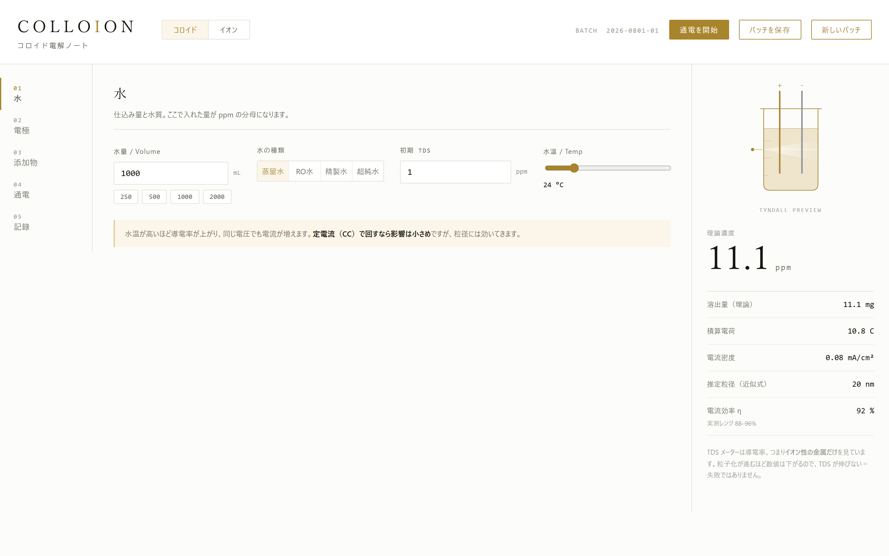
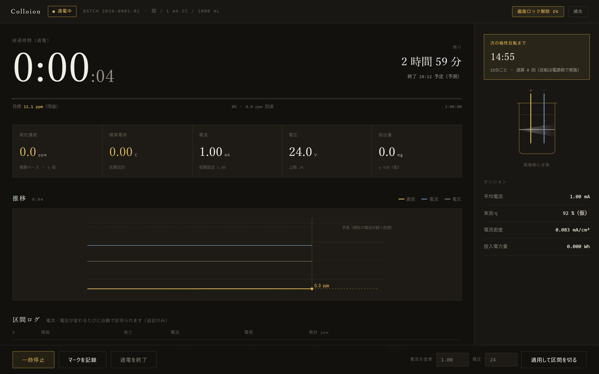

# Colloion — コロイド電解ノート

コロイド・イオン溶液の電解調製を**記録・計算するための個人の趣味実験ツール**です。

> **位置づけについて**
> これは実験条件の記録と電気化学の計算を行うラボノートであり、
> 医療・健康目的の製品ではありません。生成した溶液の効能・用途に関する情報は
> 一切扱いません。本ツールが表示する数値は理論値・推定値であり（後述の「限界」参照）、
> 分析機器による実測の代わりにはなりません。

記録はこの端末の IndexedDB に保存され、作業場でオフラインでも動きます。
任意でログインすると、同じアカウントの端末どうしで記録を同期できます（Phase 3。後述）。

| 通常モード | 通電モード（Run Mode） |
|---|---|
|  |  |

## 動作させ方

```bash
npm install
npm run dev        # 開発サーバ（同期なしで動く）
npm run build      # 本番ビルド（dist/。Worker の assets から配信する）
npm run typecheck  # 型検査（フロント・Worker）
npm run lint       # ESLint（src・worker）
npm run test       # Vitest（core・同期エンジン・Worker・主要 UI）
```

同期（Worker + D1 + ログイン）まで含めてローカルで動かす場合:

```bash
cp .dev.vars.example .dev.vars   # NEON_AUTH_BASE_URL と SYNC_ALLOWED_USER_IDS を入れる
npm run migrate:local            # ローカル D1 にマイグレーションを適用
npm run dev:worker               # ビルドして wrangler dev（http://localhost:8787）
```

`npm run dev`（vite）と `npx wrangler dev` を並べて起動すると、vite が `/api` を
wrangler dev に中継するので、画面のホットリロードを使いながら同期も試せます。
Worker のテストは `node:sqlite` を使うため Node 22.13 以上が必要です。

## 機能

- **5 工程のエディタ** — 水 / 電極 / 添加物 / 通電 / 記録。数値を触るたびに
  右パネルの理論濃度・電流密度・逆算（目標 ppm → 必要時間）が追従します。
- **化学式パーサー** — `KAl(SO4)2·12H2O` のような括弧ネスト・水和物ドット記法を
  解釈して分子量を算出。テンプレート外の試薬を式から登録できます。
  水和物は無水との取り違え（分子量が数倍違う）を警告します。
- **母液（ストック溶液）** — 濃度 [mol/L] で保存し、仕込み水量が変わっても
  目標 mmol/L を保つ滴数を逆算。スポイトの 1 滴体積は 20 滴の実測から較正します。
- **Run Mode** — 通電中の全画面モード。区間ごとのクーロン積算・極性反転の案内・
  クラッシュ復帰・Wake Lock。詳細は後述。
- **記録** — バッチは保存時点の計算値をスナップショットとして固定。実測 TDS を
  入れると電流効率 η の補正案が出ます。JSON / CSV エクスポート対応。
- **同期（任意）** — メールに届く 6 桁のコードでログインすると、バッチ・試薬・母液・
  スポイト・通電セッションが同じアカウントの端末間で同期されます。
  オフラインの間の変更は端末に溜まり、接続が戻ると送られます。

## 計算の根拠

### ファラデーの電気分解の法則

電極で反応する物質の量は、流した電気量（電荷）に比例します。
陽極から溶出する金属の質量は

```
m [g] = (M / (n × F)) × Q × η
```

- `M` : 金属の原子量 [g/mol]
- `n` : 溶出イオンの価数（Ag⁺ なら 1、Zn²⁺ なら 2）
- `F` : ファラデー定数 96485 C/mol（電子 1 mol あたりの電荷）
- `Q` : 積算電荷 [C] ＝ 電流 [A] × 時間 [s]
- `η` : 電流効率。流れた電荷のうち目的の溶出反応に使われた割合

### 電気化学当量

`M / (n × F)` は「1 クーロンあたりに溶出する質量」で、電気化学当量と呼びます。
本アプリではこの値をハードコードせず、原子量と価数から毎回導出しています
（`src/core/metals.ts` の `electrochemicalEquivalent`）。

| 金属 | M [g/mol] | n | 当量 [mg/C] |
|---|---|---|---|
| Ag | 107.868 | 1 | 1.118 |
| Au | 196.967 | 3 | 0.681 |
| Cu | 63.546 | 2 | 0.329 |
| Zn | 65.38 | 2 | 0.339 |
| Mg | 24.305 | 2 | 0.126 |
| Fe | 55.845 | 2 | 0.289 |
| Mn | 54.938 | 2 | 0.285 |

濃度は希薄水溶液の近似 `1 mg/L ≒ 1 ppm` で

```
ppm = m [mg] / 水量 [L]
```

逆算(目標 ppm → 必要時間)は同じ式を時間について解いたもので、
順算と往復で一致することをテストで保証しています。

### 母液（ストック溶液）

```
モル濃度 [mol/L] = (秤量 [g] × 含量% / 100) / 分子量 / (溶媒量 [mL] / 1000)
```

母液は**濃度で保存**するため、仕込み水量が変わっても目標 mmol/L を保つ
滴数を逆算できます。1 滴の体積はスポイト依存（0.03〜0.06 mL）なので、
20 滴の実測体積からキャリブレーションし、その値は試薬ではなく
**器具（スポイト）に紐づけて**保存します。

### 原子量の出典

原子量テーブル（`src/core/elements.ts`）は **IUPAC 2021 標準原子量の慣用値**
（conventional / abridged values, CIAAW）を採用しています。

S や Cl など同位体組成が試料により変わる元素は、IUPAC では区間表記
（S: [32.059, 32.076]、Cl: [35.446, 35.457]）であり、単一の「正しい値」が
存在しません。一方、試薬カタログの分子量は旧世代の単一値（S=32.065 等）で
計算されていることが多く、小数第 2 位で ±0.02 程度ずれます。
たとえばミョウバン KAl(SO4)2·12H2O は S を 2 原子含むため、元素の定義だけで
分子量に ±0.03 超の本質的な幅があります。

このため分子量テストの照合は **±0.05** としています（分子量 300 に対して
0.017% で、電子天秤の秤量誤差 〜0.1% より一桁小さく、実用上の影響はありません）。
登録済み試薬の分子量は登録時にスナップショットされるため、
原子量テーブルの改訂が過去の記録を書き換えることはありません。

## Run Mode（通電モード）

通電中に使う全画面モード。本質は UI ではなく**区間ごとのクーロン積算**で、
実測に基づく電荷を積み上げて理論値の精度を上げます。

- **計時はすべて時刻差分**（`Date.now()` − 開始時刻）。`setInterval` は描画更新の
  トリガーにすぎず、バックグラウンド throttle やスリープで tick が欠落しても
  積算は狂いません（テストで担保）。
- **区間（Segment）は追記のみ**。電流・電圧の変更、極性反転、一時停止/再開の
  たびに区間を閉じて新しい区間を開きます。閉じた区間は書き換えません。
- `totalCoulombs` は区間から再計算できますが冗長に保存し、起動時に整合性を
  検証して乖離があれば警告します。
- **クラッシュ耐性**: 10 秒ごと＋区間切替のたびに IndexedDB へ保存。起動時に
  未終了セッションが残っていれば復帰ダイアログを出し、中断中に通電が
  続いていたかどうか（アプリには判定できない）をユーザーが選びます。
- **終了時の書き戻し**: セッション積算に基づく値は `Batch.measured` に追加され、
  設定値ベースの `Batch.computed` は上書きされません。両方が残ることで
  η 補正の材料になります。
- 極性反転は**電源側の機能**です。アプリは「反転の時刻です」と知らせて
  記録するだけで、装置を制御しません。
- グラフの右端の破線は「現在の電流が続く前提の外挿」で、予測と明示しています。
  系列は区間境界から生成する折れ線で、全秒サンプル（3 時間 = 10800 点）は
  描きません。
- 液温は温度センサーがない前提の**手入力マーク**です。温度から電流を推定する
  ような計算は行いません（係数が装置依存で、根拠のない数値になるため）。
- Wake Lock（画面スリープ抑止）は非対応・取得失敗時もトグルを無効表示に
  フォールバックし、画面を壊しません。減光は CSS 変数の切り替えで実装
  （filter は SVG 描画品質に影響するため不使用）。

## 同期（Phase 3）

### 仕組み

- **この端末の IndexedDB が正本**です。サーバー（Cloudflare Workers + D1）とは差分だけを
  やり取りし、ログインしていなくても、通信できなくても、アプリはそのまま動きます。
- 保存のたびに、レコードの書き込みと**送信待ちキュー（outbox）**への追加を
  1 トランザクションで行います。キューは「種類:ID」単位で 1 件にまとまるので、
  Run Mode の 10 秒ごとの保存でも増え続けません。
- 1 回の同期は **pull → push** です。サーバーはユーザーごとの通し番号 `rev` を振り、
  push には「どの版を元に書き換えたか（`baseRev`）」を添えます。一致しなければ
  サーバーは競合として現在の版を返し、マージはクライアントが行います。
- 送信は保存から 2 秒後、ただし前回の同期から 30 秒は空けます。オンライン復帰・
  タブ復帰で即時、表示中は 5 分ごとに他端末の変更を取りに行きます。
- 削除は物理削除ではなく**墓標**（`deletedAt`）を残し、他端末に削除を伝えます。

### 競合したときの規則

| 種類 | 規則 |
|---|---|
| 共通 | 削除は編集より強い。それ以外は `updatedAt` が新しい方（同時刻ならサーバー側） |
| バッチ | 条件と `computed` は保存後に変わらない。`result` は後勝ち、`measured` は負けた側にしか無ければ残す |
| 母液 | 使用記録 `usages` は追記のみで、和集合を取る（2 台で別々に使った分が両方残る）。残量は「調製量 − 使用量の合計」 |
| 通電セッション | 開いた端末（`deviceId`）だけが書ける。他端末には読み取り専用で届き、クラッシュ復帰の対象にもならない |
| 試薬・スポイト | 後勝ち。シード試薬は ID 固定・`updatedAt = 0` なので、どの実データにも負ける |

アプリの状態が同期前の古い版のまま保存されても、`rev` を下げず、追記のみのデータ
（使用記録・`measured`）は失わないようにしています（`rebaseLocalWrite`）。

### 認証

- **Neon Managed Better Auth** のメール OTP（6 桁のコード）でログインします。
- フロント・同期 API・認証を **1 つの Worker・同一オリジン**で配信します。認証は
  `/api/auth/*` が Neon へ中継（リバースプロキシ）し、セッション Cookie を first-party に
  します。別サイトのままだと Safari（ITP）などで Cookie が落ちるためです。
  中継の書き換え規則（Set-Cookie を `SameSite=Lax` にして `Partitioned` を外す、
  上流の Location を自オリジンへ、Origin・Cookie・Sec-Fetch-* は素通し）は
  bitane で実機確認済みのものに合わせています。
- 中継するのは使うエンドポイントだけ（コード送信・コードでのサインイン・セッション確認・
  トークン取得・サインアウト）。パスワードでのサインアップなどは外から叩けません。
- 同期 API は `Authorization: Bearer <JWT>` です。JWT（EdDSA・15 分）は Neon の公開鍵
  （JWKS）で検証し、`iss` / `aud` は Auth URL のオリジンと照合します。
  **Worker は秘密情報を持ちません。**
- **同期を使えるのは許可リスト（`SYNC_ALLOWED_USER_IDS`）にあるユーザーだけ**です。
  Neon のサインアップは誰にでも開いているため、リストが無いと誰でもアカウントを作って
  D1 の日次上限（Cloudflare アカウント全体で共有）や容量を使い切れます。
  未設定・空なら同期 API は 503 で止まります（設定漏れで全開放にならない）。
  判定はメールアドレスではなくユーザー ID（JWT の `sub`）で行います。メールで判定すると、
  他人のアドレスで先に登録されたアカウントを通してしまうためです。
  `*` で全員に開けます。ユーザーごとの容量上限（下の「制限」）で D1 の容量は守られますが、
  D1 の日次の読み書き回数はアカウント全体で共有なので、開く範囲は慎重に決めてください。
- フロントは Neon SDK を使わず素の fetch で叩きます（bitane で、SDK がセッション情報を
  `localStorage` に流す・`/token` がキャッシュで短絡する問題を実機で確認したため）。
  セッションは HttpOnly Cookie、アクセストークンはメモリにだけ持ちます。

### 制限

| 項目 | 値 | 理由 |
|---|---|---|
| 1 回の push の件数 | 40 件 | D1 の「1 呼び出しあたりのクエリ数」は Workers Free で 50 |
| 1 レコードの大きさ | 256 KB | — |
| push の本文 | 4 MB | — |
| コードの送信 | 同じメール宛て 5 回/時、同じ IP から 20 回/時 | 認証の中継に D1 のカウンタで掛ける |
| コードでのサインイン | 同じ IP から 30 回/時 | コードごとの試行回数は Neon 側でも制限される |
| 同期 API | ユーザーごとに push 600 回/時・pull 1200 回/時 | Run Mode 中の同期（30 秒ごと）は 120 回/時程度 |
| ユーザーごとの容量 | 10,000 件・32 MB（本文の UTF-8 のバイト数） | D1 は Free で 1 DB 500 MB。上限いっぱいでも 10 人程度は収まる |

容量上限を超える push は丸ごと 507 で断り、画面には「容量上限」と出ます（送信待ちは端末に残り、
pull は続きます）。使用量を増やさない push（編集で小さくなる・既存の更新）は上限に達したあとも通ります。
**削除の墓標も本文ごとサーバーに残るので、削除しても使用量は減りません。**
使用量は `sync_usage` テーブル（`migrations/0003` のトリガーが保つ合計）から読みます。
確認と書き込みは別の呼び出しなので、同じユーザーの push が並行すると 1 回分（最大 40 件・4 MB）まで
上限を超えることがあります。

### 注意

- **別のアカウントでログインすると、この端末の記録はそのアカウントにも送られます。**
  ログイン画面で、前回と違うアカウントなら注意を出します。
- ログアウトしても端末の記録は消えません。送信待ちは次に同じアカウントで
  ログインしたときに送られます。
- 同期サーバーの無い環境（`npm run dev` を vite だけで起動したとき等）では、
  ログインの入口は表示されず、ローカル保存だけで動きます。

### 本番

https://colloion.tomu-ai.dev （1 つの Worker がフロント・`/api/sync/*`・`/api/auth/*` を配信）。
2026-10-13 に初回デプロイ済み:

- D1 `colloion`（APAC）を作成し、`migrations/` を `--remote` で適用
- secret `NEON_AUTH_BASE_URL` と `SYNC_ALLOWED_USER_IDS` を登録（`wrangler.jsonc` の vars には書かない）
- カスタムドメイン `colloion.tomu-ai.dev`（workers.dev / Preview URL は無効）を割り当て、
  Neon Auth の trusted origins に登録

更新は `npm run build && npx wrangler deploy`。
D1 のマイグレーションを足したときは、先に `npx wrangler d1 migrations apply colloion --remote`、
その後に deploy（逆の順だと、新しい Worker が古いスキーマの D1 を読んで失敗する）。

2026-10-14: ユーザーごとの容量上限（`migrations/0003`）を反映し、GitHub Pages 版
（tomu-ai963.github.io/colloion）を閉じて配信を colloion.tomu-ai.dev に一本化した。
IndexedDB はオリジンごとに分かれるので、Pages 版で付けた記録はこちらからは見えない。

2026-10-14: Neon Auth のメール送信元を、共有アドレス（`auth@mail.myneon.app`。送信数に制限がある）から
Resend の SMTP（`smtp.resend.com:465`、差出人 `colloion <no-reply@tomu-ai.dev>`）に替えた。
パスワードは colloion 専用の Resend API キー（送信のみ・`tomu-ai.dev` 限定）で、Neon 側にだけ保存している
（リポジトリ・Worker には持たない）。設定は `neon neon-auth config email-provider get` で確認できる。
本文は Neon の既定のテンプレート（英語）のまま。日本語にするには webhook（`send.otp`）で自前送信が要る。

残っていること:

1. Safari（iPhone）の実機でログインと同期を確認する

## 限界 — 表示値について必ず知っておくこと

- **ppm は理論値・推定値です。** ファラデー則と入力された電流効率から計算した
  値であり、実測ではありません。実測（TDS・pH）は記録タブで別に入力し、
  ラベルで明確に区別して表示します。
- **推定粒径は経験的な近似式**（電流密度と濃度からの目安）であり、
  TEM や DLS による測定値ではありません。
- **ファラデー則が成立しない金属があります。**
  - Mg — 水と直接反応して自己腐食するため（負差効果）、実効の電流効率が
    130〜200% と 100% を超えます。理論値は**下限**としてのみ表示します。
  - Ca — 金属カルシウムは水と激しく反応するため電解不可（当量 0）。
  - Pt — 不溶性電極。逆算は「到達不能」を返します。
- **TDS メーターは導電率**を測っており、イオン性の金属しか検出しません。
  粒子化が進むと数値はむしろ下がるため、「TDS が伸びない＝失敗」ではありません。
- イオンモードでチンダル光条が消えるのは演出ではなく仕様です。
  真の溶液は光を散乱しません。

## 構成

```
src/
  core/       UI 非依存の計算ロジック・同期のマージ規則（ここだけでテストが完結）
  store/      Zustand ストアと派生計算（derive）
  storage/    StorageAdapter / SyncStore + IndexedDB / メモリ実装・スキーマ移行
  sync/       同期エンジン・通信プロトコル・サーバーの基準実装（MemorySyncServer）
  auth/       ログイン（Neon Auth を /api/auth/* 経由で）
  ui/         パネル・共通コンポーネント・readout・Run Mode・同期の画面
worker/       Cloudflare Worker（同期 API・認証の中継・アセット配信）
migrations/   D1 のスキーマ
docs/         参照用 UI モック・スクリーンショット
```

Worker の push / pull は、サーバーの基準実装（`src/sync/memoryServer.ts`）と同じ操作で
同じ結果（`rev` の値まで）になることをテストで確かめています（`worker/sync.test.ts`）。

## License

[MIT](LICENSE)
